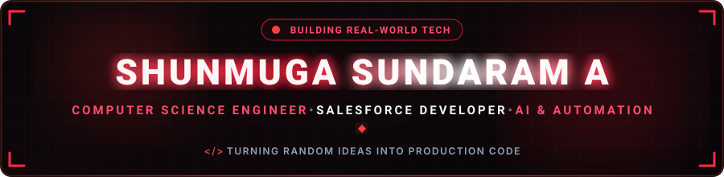
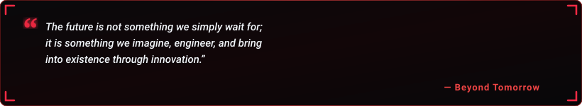

  

  

  
  &nbsp;
  
  &nbsp;
  
  &nbsp;
  
  &nbsp;
  
  &nbsp;
  

  

---

<h2 align="center">🔴 About Me</h2>

  

  

  Hey! I'm <b>Shunmuga Sundaram A</b>, a passionate <b>Computer Science Engineering student & developer</b> based in Chennai, India. 
  I am focused on Salesforce Development, exploring Apex, SOQL and Lightning Web Components (LWC), while building full-stack applications using Java, React and Spring Boot.

  
  &nbsp;
  
  &nbsp;
  

  💬 <b>Let's Discuss:</b> Salesforce, Apex, LWC, SOQL, Java, React, Spring Boot & Full Stack Development. 
  ⚡ <b>Philosophy:</b> <i>"Turning imagination into innovation, one line at a time."</i>

<table width="100%" border="0" align="center">
<tr>
<td width="50%" align="center" style="padding: 14px;">
  <h4>🍿 Business Project</h4>
  
<b>AYYAN SNACKS SPOT</b> Business Website Development

</td>
<td width="50%" align="center" style="padding: 14px;">
  <h4>🌱 Active Deep Dives</h4>
  
<b>Salesforce & Java</b> Apex, LWC & Spring Boot

</td>
</tr>
<tr>
<td width="50%" align="center" style="padding: 14px;">
  <h4>🎓 Education</h4>
  
<b>St. Joseph's Institute of Technology</b> B.E. Computer Science & Engineering

</td>
<td width="50%" align="center" style="padding: 14px;">
  <h4>🤝 Collaboration</h4>
  
<b>Salesforce & Web Development</b> Open to internship opportunities

</td>
</tr>
</table>

---

<h2 align="center">🔴 Featured Project Spotlight</h2>

<table width="100%" border="0" align="center">
<tr>
<td align="center" style="padding: 22px;">

  <h3>🍿 AYYAN SNACKS SPOT</h3>

  

    <i>A business website developed for AYYAN SNACKS SPOT, creating a dedicated digital presence to showcase the brand and bring its business online through a responsive web experience.</i>
  

   

  

    
    &nbsp;&nbsp;
    
  

</td>
</tr>
</table>

---

<h2 align="center">🧩 LeetCode Problem Solving</h2>

  <i>Live real-time tracker of coding challenges & algorithmic problem-solving milestones.</i>

  

  
  &nbsp;&nbsp;
  

---

<h2 align="center">🛠️ Tech Stack & Skills</h2>

<b>Core Programming Languages</b>

  

<b>Frontend Development</b>

  

<b>Backend, Cloud & Databases</b>

  

<b>Salesforce Development</b>

  
  &nbsp;
  
  &nbsp;
  
  &nbsp;
  

<b>AI, Computer Vision & Tools</b>

  

---

<h2 align="center">📊 GitHub Analytics & Activity</h2>

  
  &nbsp;&nbsp;
  

  

  

---

<h2 align="center">⚡ Contribution Journey</h2>

  

---

<h2 align="center">📬 Let's Connect &amp; Collaborate</h2>

  <i>Whether you want to discuss Salesforce Development, explore full-stack collaboration, or just say hello — my inbox is always open!</i>

<table border="0" align="center">
<tr>
<td align="center" width="220" style="padding: 16px;">
  <a href="https://www.linkedin.com/in/shunmuga-sundaram-a-3080102a1/" target="_blank">
    
      
    
  </a>
   
  <b>Professional Network</b>
</td>

<td align="center" width="220" style="padding: 16px;">
  <a href="mailto:shunmugasundar07@gmail.com">
    
      
    
  </a>
   
  <b>Direct Collaboration</b>
</td>
</tr>
</table>

  

